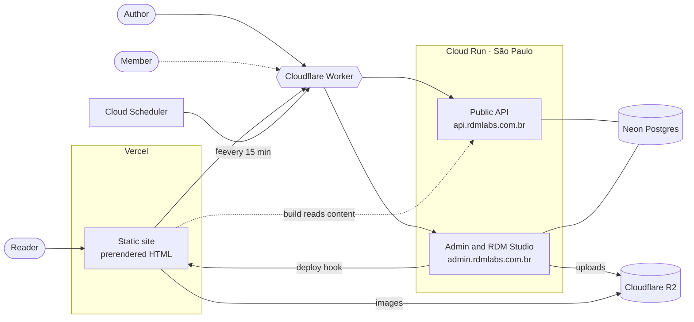

# Cosmos

My personal blog, built as a 3D star map. Each post is a star, placed in the sky by its publication date. Available in Portuguese and English.

**Live:** [cosmos.rdmlabs.com.br](https://cosmos.rdmlabs.com.br) · **Architecture write-up:** [docs/architecture.md](docs/architecture.md)
<!--
 TODO: replace OWNER/REPO with the real repository path 
[](https://github.com/OWNER/REPO/actions)

<!-- TODO: record a 10–15 s GIF of the constellation (pan, zoom, open a post) and save it here 
-->

## What it is

Cosmos is where I publish articles, study notes, projects and the occasional post about routine (and coffee). Most blogs look the same: a feed, a sidebar, a grid of cards. I wanted the home page itself to be the way you explore, without making posts harder to reach.

So every star is a normal link, every post has a real URL in both languages, and the whole archive is also served as plain HTML for crawlers, screen readers and anyone browsing with JavaScript off.

It's also an exercise in constraints. One person builds and runs all of it, for about US$ 0.30 a month.

## Five decisions everything else follows from

1. **Readers never wait on a server.** The site is static HTML on a CDN. The backend exists for me, when I'm writing, and for the build that regenerates the site. If it goes down, the site keeps working; only publishing stops.
2. **The domain is plain TypeScript.** Time, positions, routes, the Markdown parser and the camera live in [`src/core/`](src/core/), with no DOM, React or Three.js. Most of the tests are there, and the browser, the prerender and the editor's preview all run the same code.
3. **One parser, one renderer.** Posts are stored in a small Markdown subset, parsed by hand into a tree and drawn by a single component, [`ArticleBody`](src/components/). No HTML string crosses the system.
4. **Nothing is stored that can be derived.** A star's position comes from its date and a hash of its slug. Reading time and the table of contents are computed from the content. Publishing a new post can't move the old ones.
5. **Production and development differ only in environment variables.** The request that regenerates the site locally is the same one that triggers a Vercel build in production.

## Stack

| Layer | Technologies |
|---|---|
| Site | React 18, TypeScript, Vite, Three.js (used directly, without React Three Fiber), CSS Modules, CSS custom properties for design tokens |
| Backend | Laravel 13, Filament 5 (admin), RDM Studio (a React editor), Sanctum and Socialite for reader accounts, PostgreSQL 18 |
| Infrastructure | Vercel (site and cookieless analytics), Google Cloud Run in São Paulo (backend), Neon (Postgres), Cloudflare (DNS, edge Worker, R2 media), Terraform, GitHub Actions |

Why Laravel 13 and not 11? Every Laravel 11 release still available has open security advisories, and Composer refuses to install them. Filament 3 doesn't run on Laravel 13, hence Filament 5.

## How it fits together



The system is split by who is waiting. Readers get static files from a CDN. The backend serves the author, the build and, soon, signed-in readers. The two halves share one JSON API, and the build reads it through the same adapter the browser uses.

## Running it

Everything runs in Docker (Compose v2), so you don't need Node or PHP installed.

<!-- TODO: if the backend needs an env file, add the copy step here, e.g. cp backend/.env.example backend/.env -->

```sh
docker compose up node                                  # the site on :5174, with hot reload
docker compose run --rm node npm run check              # typecheck, lint and tests
docker compose --profile backend up -d db app queue scheduler web   # API, admin and Nginx on :8080
```

Without the backend, the site reads a seeded archive bundled with the code, so the first command is enough to explore the interface.

## Where things live

| Path | What you'll find |
|---|---|
| [`src/core/`](src/core/) | The domain in pure TypeScript, with most of the test suite |
| [`src/three/`](src/three/) | The WebGL scene and its shaders, outside React |
| [`src/components/`](src/components/), [`src/hooks/`](src/hooks/) | The React interface, each component next to its CSS Module |
| [`src/prerender/`](src/prerender/) | The Node step that writes one HTML file per route |
| [`src/admin/`](src/admin/) | RDM Studio, the editor I write in |
| [`backend/app/Modules/`](backend/app/Modules/) | Laravel modules: Content, Identity, Activity |
| [`e2e/`](e2e/) | Playwright tests against the real Nginx and the full stack |
| [`docker/`](docker/) | Development images and the production image |
| [`infra/`](infra/) | Terraform for Google Cloud, Cloudflare and GitHub, plus the edge Worker |
| [`docs/`](docs/) | The architecture write-up |

## Quality

Every pull request runs:

- **Frontend:** typecheck, lint, about 650 Vitest tests (including a 500/1000-post scale budget) and the build with prerender.
- **Backend:** Pint, PHPStan level 8 with no baseline, Deptrac for module boundaries, and about 190 tests against a real Postgres, run twice: with development settings and with the connection settings production needs.
- **End-to-end:** Playwright against the build served by the real Nginx, including a check that fails on any CSP violation.
- **Integration:** the full stack. Publishing a post makes it answer 200 from disk, deleting it brings back a 404, and a seeded admin session drives RDM Studio through write, publish, read and unpublish.
- **Production image:** the real image refuses an incomplete configuration, and each host answers only its own routes.
- **Infrastructure:** Terraform format and validate, plus tests for the edge Worker.

## Status

**Done:** the interactive site and Three.js scene, translated routing, prerendering and SEO, the API, the admin panel and RDM Studio, live publishing, the reading view with per-category themes, production infrastructure, and the backend for reader accounts.

**Next:** the reader sign-in interface and privacy page, then comments and sharing, monitoring before opening accounts to the public, and gamification built on the activity log.

## Trade-offs and what I'd do differently

- **The hand-written parser.** It works because the Markdown subset is small and closed, and owning it keeps the site, the prerender and the editor in agreement. The cost is that every new block type touches the parser, the serializer, the renderer and their tests. If the subset keeps growing, I'll revisit this.
- **A Cloudflare Worker instead of Google's load balancer.** Cloud Run can't map a custom domain in São Paulo, and the load balancer has a fixed monthly cost. The Worker is free, but it's one more piece I have to maintain and secure.
- **A 15-minute scheduler.** Each tick wakes the database, so a one-minute tick would keep it awake around the clock. The price is that a scheduled post can go live up to 15 minutes late. For a blog, that's fine.
- **The `_test` guard.** The backend suite refuses to run unless the database name ends in `_test`. That guard exists because it once mattered.
  <!-- TODO: tell in one or two lines what happened -->

## Going deeper

[docs/architecture.md](docs/architecture.md) covers the parts this page skips: the render loop and why nothing that changes every frame goes through React, routing and SEO, how content is parsed and rendered, the modular monolith and its boundaries, the publishing pipeline, reader accounts and privacy, the edge Worker, deployment and cost.

## Author

Built by **Rafael Dorneles Machado**, full stack software engineer (PHP/Laravel, React).
[Portfolio](https://portfolio.rdmlabs.com.br) · [LinkedIn](https://www.linkedin.com/in/rafael-dorneles-machado-8478b3172) · [Laravel internals series (PT)](https://cosmos.rdmlabs.com.br/pt/publicacoes/marco-zero-laravel-antes-do-primeiro-comando)

<!-- TODO: add a LICENSE file and name it here, or state "All rights reserved" if the code is for viewing only -->
