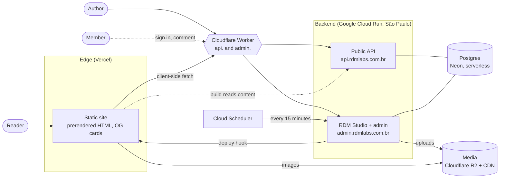
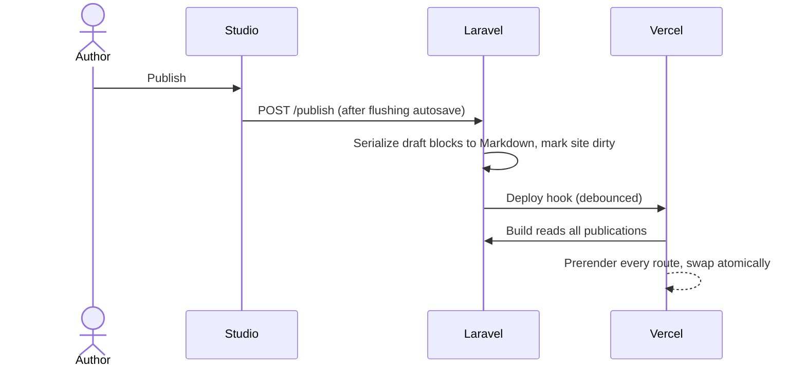
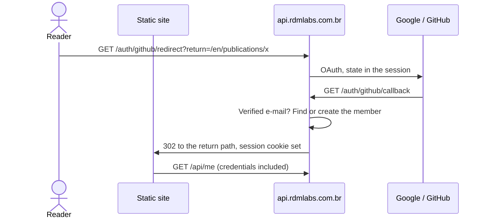

# Architecture

> Target architecture for the public release of Cosmos. The section
> [Current state](#current-state) says what already runs today; everything else
> describes where the system is going and why.

## Context

Cosmos is a personal publication space: articles, studies, projects and field
notes, navigated as a 3D constellation. One author writes; many people read.
Later, readers sign in to comment and share, and eventually earn achievements.

That shape drives every decision below:

- **Reads outnumber writes by orders of magnitude.** A reader must never wait
  on, or be able to take down, the system the author writes with.
- **The content must exist without JavaScript.** Crawlers, screen readers and
  slow devices get real HTML, not an empty shell waiting for an API.
- **One person operates it.** Anything that needs a server to be patched,
  a disk to be watched or a cluster to be tuned is a cost paid every month.

## Overview

The system is split in two along the line that matters most, **who is
waiting**:

| | Frontend (edge) | Backend (API) |
|---|---|---|
| Serves | Readers | The author, and later members |
| Shape | Static files on a CDN | One stateless container |
| Scales by | The CDN, without limit | Cloud Run instances, horizontally |
| If it fails | Nothing loads (CDN outage) | The site still reads; only writing and community features stop |

A contract in between, the JSON API, is the only thing they share.

## Components

### Static site (Vercel)

React 18, TypeScript and Vite, with a Three.js scene for the constellation.
After the client build, a prerender step written in the same TypeScript writes
one HTML document per route: the article itself, its canonical URL, `hreflang`,
Open Graph tags, a 1200×630 card image and JSON-LD. The constellation is
progressive enhancement over that document.

The prerender reads content through the same adapter the browser uses
(`createHttpSource`), so what is written to disk and what React renders on top
of it come from one code path.

### Edge for the backend (Cloudflare Worker)

Cloud Run's own custom-domain mapping is not available in São Paulo, and is a
preview feature where it is. Cloudflare already serves the DNS, so a small
Worker receives `api.` and `admin.` and forwards to the service's `*.run.app`
URL. It sends:
- the original host in `X-Forwarded-Host`;
- the client IP Cloudflare saw, overwriting whatever the client sent;
- a shared secret.

The app answers 404 to anything that arrives without the secret, so the
`run.app` URL is not a back door.

The Worker is also the first defense against bots. Every request that reaches
Cloud Run can wake an instance and the database, so whatever can be answered
at the edge stops there:
- each host forwards only the paths it serves; scans for `/wp-admin`, `/.env`
  and the like get a 404 from the Worker;
- `robots.txt` comes from the Worker and closes both hosts to crawlers, and
  every backend response carries `X-Robots-Tag: noindex`;
- the public read API is cached at the edge for a minute, requested without
  cookies so that no response carries a session. The site's build sends an
  internal token and always reads from the origin, so publishing never
  rebuilds the site from stale content.

Behind that, Laravel rate-limits the API per client IP (the one Cloudflare
saw, not one a client can claim), Cloud Run is capped at three instances, and
readers never touch the backend at all: the site is static files on a CDN.

### API and studio (Cloud Run)

Laravel 13 in a single container image (FrankenPHP: HTTP server and PHP in
one process), run on Cloud Run in São Paulo: no server to manage,
scale to zero while idle, horizontal scaling under load. The container keeps no
state on its own disk. Sessions, cache and queues live in Postgres; media lives
in object storage.

The admin (Filament) and the RDM Studio, a React editor with autosave,
scheduling and live preview, run on their own host, `admin.rdmlabs.com.br`. The
public API runs on `api.rdmlabs.com.br`. One deployment, two hosts. See
[Two hosts, one app](#two-hosts-one-app).

### Database (Neon)

Postgres 18, serverless. It also holds full-text search: a generated
`tsvector` per language with the matching dictionary (Portuguese stemming for
`pt`, English for `en`).

### Media (Cloudflare R2)

The studio re-encodes every upload to WebP, capped at 1600px wide, and stores
it in an S3-compatible bucket served through a CDN on its own domain. Files are
named by UUID and never rewritten, so they are cached forever.

### Scheduler (Cloud Scheduler)

A managed cron that calls the backend every 15 minutes. It publishes
scheduled posts and flushes pending site rebuilds. No worker process is kept
alive just to watch the clock.

Why not every minute: each tick wakes the database, and Neon only suspends
after five idle minutes. A one-minute tick would keep it awake around the
clock and exhaust the free compute hours. Fifteen minutes is the trade:
a scheduled post goes out up to fifteen minutes late.

## Key flows

### Reading

The reader's browser asks the CDN for `/en/publications/{slug}` and receives
finished HTML, with no backend in the request path. React then mounts the
constellation on top. Community features, once they exist, load from the API
after the page is already readable.

### Publishing

Drafts are stored as structured blocks (`jsonb`). The published body is
Markdown, the only format the site renders. The serializer guarantees
**fidelity**: every block of the draft comes back from the site's parser as
exactly one block of the same type and content, and a test suite proves it
case by case.

Rebuilds are **debounced**. Each save marks the site dirty; a deploy hook fires
at most once a minute, and the scheduler's next tick sends the trailing one.
Ten quick edits cost one build, not ten.

### Scheduled publishing

`scheduled` is a status, not only a future date. On each tick, the scheduler
moves due posts to `published`, which marks the site dirty like any other
save. The command compares counts instead of time windows, so a paused
scheduler catches up instead of skipping posts.

### Member sign-in

The reader signs in with Google or GitHub. A member is linked to the
provider's user id, never to the e-mail, which can change; a second provider
joins the same account only when both declared the same verified e-mail. The
return path must be a path on the site: any other host, `//host` or `/\host`
falls back to the home page, so the callback is never an open redirect.

The SPA on `cosmos.rdmlabs.com.br` then talks to `api.rdmlabs.com.br` with
Laravel Sanctum in SPA mode: an HttpOnly session cookie with CSRF protection.
No token is ever stored in `localStorage`. Both hosts share the registrable
domain, so the cookie is same-site and needs no third-party-cookie
workaround. Sanctum only accepts the `member` guard: the admin session never
authenticates the site's API, even with matching ids.

CORS has two policies. The member routes allow credentials and exactly one
origin, the site. The public read API allows any origin and no credentials. A
single `*` policy with credentials would reflect any origin, and any page on
the web could read a signed-in reader's profile.

The prerendered HTML stays anonymous and identical for everyone; the session
only exists in the browser, after `/api/me` answers. `/api/me` answers 204,
not 401, to a visitor without a session, so anonymous page views do not log
errors.

## Design decisions

Each entry names the choice, the alternative it beat, and the reason.

**Static-first over server-side rendering.** The content changes when the
author publishes, not when someone reads. Rendering at publish time turns every
read into a CDN hit. SSR would put a server on the hot path to recompute HTML
that did not change.

**A modular monolith over microservices.** The backend is one deployable app,
divided into modules with explicit boundaries:

| Module | Owns | State |
|---|---|---|
| Content | Publications, drafts, media, the studio | Built |
| Identity | Member accounts, social login, profiles, data export and deletion | Built (API) |
| Activity | The append-only log of members' domain actions | Built |
| Community | Comments, shares, moderation | Planned |
| Gamification | Points, achievements, leaderboards | Planned |

Modules talk through domain events, such as `MemberRegistered` or
`CommentPosted`, never by reading each other's tables. A module's public
contract is its events and interfaces; nothing else in it can be imported from
outside. Deptrac checks this in CI, along with the rule that the shared
platform code (middleware, the admin's own sign-in) depends on no module.
That boundary lets a module be extracted later if it ever needs to scale on
its own; until then, one deploy and one database are far cheaper to run.

Data export shows the pattern. `GET /api/me/export` must include everything
any module stores about a person, but Identity cannot import the other
modules. Identity publishes a `PersonalDataSource` interface, and each module
registers its own implementation. A new module adds itself to the export
without Identity changing.

**An append-only activity log from day one.** Every domain action a member
takes is recorded by the Activity module, which listens to the other modules'
events. Gamification, when it arrives, is a projection over that history, so
points can be computed for things people did before the feature existed.
Sign-ins and page reads are not recorded: they would be personal data with no
use.

The log is append-only in the database itself, not only in the model. A
Postgres trigger refuses `UPDATE` and `DELETE`. The one exception is account
deletion, which may rewrite an entry's payload, and nothing else, inside its
own transaction.

**Privacy built in, not bolted on.** Deleting an account removes the linked
provider identities and anonymizes the member row, in one transaction. The
row keeps its id, so activities keep pointing at someone and aggregate
numbers do not shift. The export returns the profile, the identities and
every module's records. The only cookies are the session and the CSRF token,
both essential, so no consent banner is needed. Page views are counted by
Vercel Web Analytics, which sets no cookie and keeps no persistent
identifier, and only on the production build.

**A Worker at the edge over a cloud load balancer.** The load balancer is
Google's production answer for custom domains, at a fixed monthly cost even
when idle. The Worker does the same job for this traffic for free, keeps the
backend in the same city as its readers, and is about thirty lines of tested
code.

**Fail-fast configuration.** The production image refuses to start when a
production setting is missing: a debug flag left on, local disk for media, a
missing edge secret. A broken revision never passes its health check, so
Cloud Run keeps serving the previous one.

**Serverless containers over a VM or Kubernetes.** Cloud Run runs the same
container image used in development and CI, scales to zero, and leaves no OS to
patch. Kubernetes would solve a scheduling problem this system does not have.

**A hand-written Markdown subset instead of a library or HTML.** The parser
supports headings, paragraphs, quotes, lists, code, images and inline
formatting, and nothing else. It produces a tree, never an HTML string, and
React escapes all text. The only remaining injection vector is URLs, and those
are allowlisted by protocol. Syntax highlighting follows the same rule: tokens,
never markup.

**Two hosts, one app.** The admin session cookie is host-only on
`admin.rdmlabs.com.br`. The member session is shared with the SPA's domain. If
both used the same domain-wide cookie, the admin session would travel with
every request to the static site's host, which is a third party's
infrastructure.

**Pure domain core.** `src/core/` is TypeScript with no DOM, no React and no
Three.js: positions, routing, SEO headers, the Markdown parser, highlighting.
Most of the test suite lives there, and the browser, the prerender and the
studio preview all import the same functions.

**Deterministic layout.** A star's position is derived from its date and a
hash of its slug, never stored. Publishing a new post never moves an existing
one, so shared links and the reader's memory of the sky stay valid.

## Quality attributes

- **Performance:**
  - Readers get prerendered HTML from the edge.
  - Nothing that changes per frame passes through React: one
    `requestAnimationFrame` loop writes transforms and shader uniforms directly.
  - The renderer lowers its own resolution when frames run long, and never
    climbs back, to avoid oscillation.
- **Scalability:**
  - Read load scales with the CDN.
  - Write and community load scales with Cloud Run instances. They are
    stateless, so any instance can serve any request.
- **Availability:** a backend outage degrades the site to read-only; it never
  takes the articles down.
- **Security:**
  - A strict CSP on the site (`script-src 'self'`, no inline scripts).
  - Clickjacking protection on every response.
  - The admin is gated by Google sign-in with a single-address allowlist.
  - The API and login routes are rate-limited.
  - Uploads are re-encoded, and SVG is refused.
  - CORS on the public API allows `GET` only.
- **Accessibility:**
  - Every star is a real link.
  - A full, non-virtualized index of the archive exists for screen readers.
  - Keyboard focus moves the camera.
  - The content works without JavaScript.
- **Cost:** about US$ 0.30 a month at this scale, all of it Secret Manager.
  Every other component is billed per use and sits in a free tier: the
  Vercel Hobby plan, Cloudflare (DNS, the Worker, R2), Cloud Run scaling to
  zero, one Cloud Scheduler job, Neon's free plan, and three images in
  Artifact Registry.

## Delivery

GitHub Actions runs on every pull request:
- type checking, lint and about 590 unit tests;
- PHPStan at level 8, Deptrac for module boundaries, and the backend suite
  against a real Postgres;
- Playwright end-to-end tests, including a full write-publish-read-unpublish
  cycle through the studio.

On `main`, the pipeline builds the backend image and then:
1. pushes it to Artifact Registry;
2. runs migrations as a one-off Cloud Run job;
3. shifts traffic to the new revision.

The pipeline authenticates through Workload Identity Federation, with no
long-lived keys. Vercel deploys the site from the same commit.

Infrastructure is described in Terraform (`infra/`): Cloud Run, Scheduler,
secrets, identity federation, the R2 bucket, the edge Worker and DNS. Secret
values never pass through Terraform state, except the edge secret it generates
itself.

## Current state

What runs today, before the migration:

- The static site is live on Vercel, built from the seed archive bundled with
  the code.
- The backend runs locally under Docker Compose: Nginx, PHP-FPM, Postgres, a
  queue worker and a scheduler. Publishing regenerates the site into a volume
  served by Nginx.
- The production path is built: the image, the Terraform, the edge Worker and
  the deploy pipeline. What is missing is the first `terraform apply` and the
  cut-over (stage 1, task 1.8 of the plan).
- The backend of stage 2 is built: the Identity and Activity modules, social
  sign-in, the member API, data export and account deletion. The site does not
  show the session yet: its sign-in interface waits on a design handoff, as
  does the privacy page.
- Community and Gamification are planned.

The migration plan is in
[`docs/superpowers/plans/2026-10-18-deploy-e-identidade.md`](superpowers/plans/2026-10-18-deploy-e-identidade.md).
