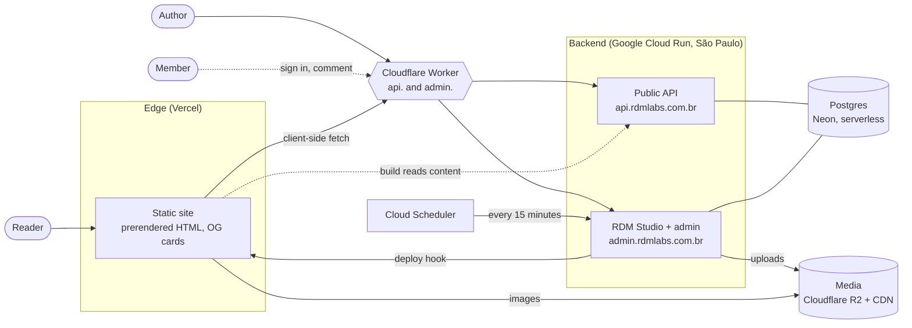
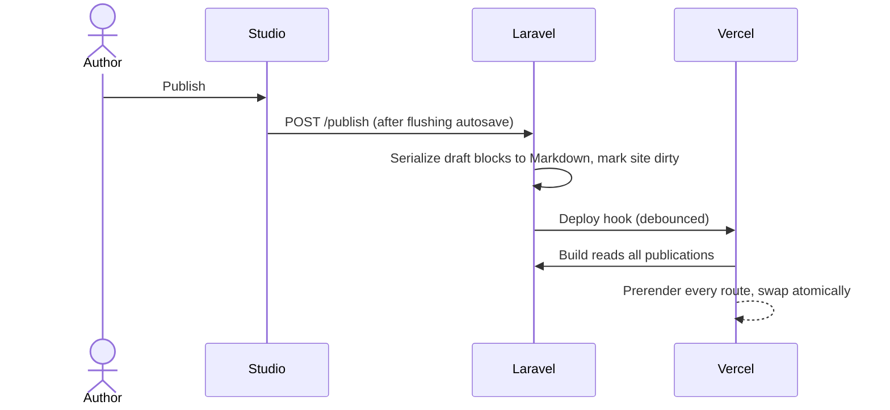
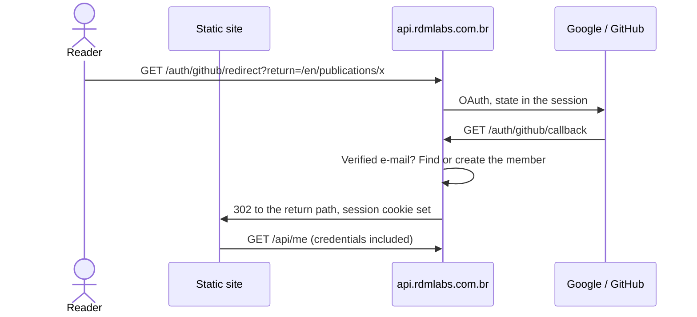

# Architecture

> Target architecture for the public release of Cosmos. The section
> [Current state](#current-state) says what already runs today; everything else
> describes where the system is going and why.

## Context

Cosmos is a personal publication space: articles, studies, projects and field
notes, navigated as a 3D constellation. One author writes; many people read.
Later, readers sign in to comment and share, and eventually earn achievements.

That shape drives every decision below:

- **Reads outnumber writes by orders of magnitude.** A reader must never wait
  on, or be able to take down, the system the author writes with.
- **The content must exist without JavaScript.** Crawlers, screen readers and
  slow devices get real HTML, not an empty shell waiting for an API.
- **One person operates it.** Anything that needs a server to be patched,
  a disk to be watched or a cluster to be tuned is a cost paid every month.

## Overview

The system is split in two along the line that matters most, **who is
waiting**:

| | Frontend (edge) | Backend (API) |
|---|---|---|
| Serves | Readers | The author, and later members |
| Shape | Static files on a CDN | One stateless container |
| Scales by | The CDN, without limit | Cloud Run instances, horizontally |
| If it fails | Nothing loads (CDN outage) | The site still reads; only writing and community features stop |

A contract in between, the JSON API, is the only thing they share.

## Components

### Static site (Vercel)

React 18, TypeScript and Vite, with a Three.js scene for the constellation.
After the client build, a prerender step written in the same TypeScript writes
one HTML document per route: the article itself, its canonical URL, `hreflang`,
Open Graph tags, a 1200×630 card image and JSON-LD. The constellation is
progressive enhancement over that document.

The prerender reads content through the same adapter the browser uses
(`createHttpSource`), so what is written to disk and what React renders on top
of it come from one code path.

### Edge for the backend (Cloudflare Worker)

Cloud Run's own custom-domain mapping is not available in São Paulo, and is a
preview feature where it is. Cloudflare already serves the DNS, so a small
Worker receives `api.` and `admin.` and forwards to the service's `*.run.app`
URL. It sends:
- the original host in `X-Forwarded-Host`;
- the client IP Cloudflare saw, overwriting whatever the client sent;
- a shared secret.

The app answers 404 to anything that arrives without the secret, so the
`run.app` URL is not a back door.

The Worker is also the first defense against bots. Every request that reaches
Cloud Run can wake an instance and the database, so whatever can be answered
at the edge stops there:
- each host forwards only the paths it serves; scans for `/wp-admin`, `/.env`
  and the like get a 404 from the Worker;
- `robots.txt` comes from the Worker and closes both hosts to crawlers, and
  every backend response carries `X-Robots-Tag: noindex`;
- the public read API is cached at the edge for a minute, requested without
  cookies so that no response carries a session. The site's build sends an
  internal token and always reads from the origin, so publishing never
  rebuilds the site from stale content.

Behind that, Laravel rate-limits the API per client IP (the one Cloudflare
saw, not one a client can claim), Cloud Run is capped at three instances, and
readers never touch the backend at all: the site is static files on a CDN.

### API and studio (Cloud Run)

Laravel 13 in a single container image (FrankenPHP: HTTP server and PHP in
one process), run on Cloud Run in São Paulo: no server to manage,
scale to zero while idle, horizontal scaling under load. The container keeps no
state on its own disk. Sessions, cache and queues live in Postgres; media lives
in object storage.

The admin (Filament) and the RDM Studio, a React editor with autosave,
scheduling and live preview, run on their own host, `admin.rdmlabs.com.br`. The
public API runs on `api.rdmlabs.com.br`. One deployment, two hosts. See
[Two hosts, one app](#two-hosts-one-app).

### Database (Neon)

Postgres 18, serverless. It also holds full-text search: a generated
`tsvector` per language with the matching dictionary (Portuguese stemming for
`pt`, English for `en`).

### Media (Cloudflare R2)

The studio re-encodes every upload to WebP, capped at 1600px wide, and stores
it in an S3-compatible bucket served through a CDN on its own domain. Files are
named by UUID and never rewritten, so they are cached forever.

### Scheduler (Cloud Scheduler)

A managed cron that calls the backend every 15 minutes. It publishes
scheduled posts and flushes pending site rebuilds. No worker process is kept
alive just to watch the clock.

Why not every minute: each tick wakes the database, and Neon only suspends
after five idle minutes. A one-minute tick would keep it awake around the
clock and exhaust the free compute hours. Fifteen minutes is the trade:
a scheduled post goes out up to fifteen minutes late.

## Key flows

### Reading

The reader's browser asks the CDN for `/en/publications/{slug}` and receives
finished HTML, with no backend in the request path. React then mounts the
constellation on top. Community features, once they exist, load from the API
after the page is already readable.

### Publishing

Drafts are stored as structured blocks (`jsonb`). The published body is
Markdown, the only format the site renders. The serializer guarantees
**fidelity**: every block of the draft comes back from the site's parser as
exactly one block of the same type and content, and a test suite proves it
case by case.

Rebuilds are **debounced**. Each save marks the site dirty; a deploy hook fires
at most once a minute, and the scheduler's next tick sends the trailing one.
Ten quick edits cost one build, not ten.

### Scheduled publishing

`scheduled` is a status, not only a future date. On each tick, the scheduler
moves due posts to `published`, which marks the site dirty like any other
save. The command compares counts instead of time windows, so a paused
scheduler catches up instead of skipping posts.

### Member sign-in

The reader signs in with Google or GitHub. A member is linked to the
provider's user id, never to the e-mail, which can change; a second provider
joins the same account only when both declared the same verified e-mail. The
return path must be a path on the site: any other host, `//host` or `/\host`
falls back to the home page, so the callback is never an open redirect.

The SPA on `cosmos.rdmlabs.com.br` then talks to `api.rdmlabs.com.br` with
Laravel Sanctum in SPA mode: an HttpOnly session cookie with CSRF protection.
No token is ever stored in `localStorage`. Both hosts share the registrable
domain, so the cookie is same-site and needs no third-party-cookie
workaround. Sanctum only accepts the `member` guard: the admin session never
authenticates the site's API, even with matching ids.

CORS has two policies. The member routes allow credentials and exactly one
origin, the site. The public read API allows any origin and no credentials. A
single `*` policy with credentials would reflect any origin, and any page on
the web could read a signed-in reader's profile.

The prerendered HTML stays anonymous and identical for everyone; the session
only exists in the browser, after `/api/me` answers. `/api/me` answers 204,
not 401, to a visitor without a session, so anonymous page views do not log
errors.

## Design decisions

Each entry names the choice, the alternative it beat, and the reason.

**Static-first over server-side rendering.** The content changes when the
author publishes, not when someone reads. Rendering at publish time turns every
read into a CDN hit. SSR would put a server on the hot path to recompute HTML
that did not change.

**A modular monolith over microservices.** The backend is one deployable app,
divided into modules with explicit boundaries:

| Module | Owns | State |
|---|---|---|
| Content | Publications, drafts, media, the studio | Built |
| Identity | Member accounts, social login, profiles, data export and deletion | Built (API) |
| Activity | The append-only log of members' domain actions | Built |
| Community | Comments, the reaction, moderation | Built (API and moderation) |
| Gamification | Points, achievements, leaderboards | Planned |

Modules talk through domain events, such as `MemberRegistered` or
`CommentPosted`, never by reading each other's tables. A module's public
contract is its events and interfaces; nothing else in it can be imported from
outside. Deptrac checks this in CI, along with the rule that the shared
platform code (middleware, the admin's own sign-in) depends on no module.
That boundary lets a module be extracted later if it ever needs to scale on
its own; until then, one deploy and one database are far cheaper to run.

Data export shows the pattern. `GET /api/me/export` must include everything
any module stores about a person, but Identity cannot import the other
modules. Identity publishes a `PersonalDataSource` interface, and each module
registers its own implementation. A new module adds itself to the export
without Identity changing.

Reading works the same way in the other direction. Content publishes
`PublishedPublications`, which answers whether a slug is live in a language,
so a module that attaches things to publications never queries Content's
tables. Both the contract and the public API use the same `live` scope
(published, dated in the past), so "visible to readers" has one definition.

**An append-only activity log from day one.** Every domain action a member
takes is recorded by the Activity module, which listens to the other modules'
events. Gamification, when it arrives, is a projection over that history, so
points can be computed for things people did before the feature existed.
Sign-ins and page reads are not recorded: they would be personal data with no
use.

The log is append-only in the database itself, not only in the model. A
Postgres trigger refuses `UPDATE` and `DELETE`. The one exception is account
deletion, which may rewrite an entry's payload, and nothing else, inside its
own transaction.

**Privacy built in, not bolted on.** Deleting an account removes the linked
provider identities and anonymizes the member row, in one transaction. The
row keeps its id, so activities keep pointing at someone and aggregate
numbers do not shift. The export returns the profile, the identities and
every module's records. The only cookies are the session and the CSRF token,
both essential, so no consent banner is needed. Page views are counted by
Vercel Web Analytics, which sets no cookie and keeps no persistent
identifier, and only on the production build.

**A Worker at the edge over a cloud load balancer.** The load balancer is
Google's production answer for custom domains, at a fixed monthly cost even
when idle. The Worker does the same job for this traffic for free, keeps the
backend in the same city as its readers, and is about thirty lines of tested
code.

**Fail-fast configuration.** The production image refuses to start when a
production setting is missing: a debug flag left on, local disk for media, a
missing edge secret. A broken revision never passes its health check, so
Cloud Run keeps serving the previous one.

**Serverless containers over a VM or Kubernetes.** Cloud Run runs the same
container image used in development and CI, scales to zero, and leaves no OS to
patch. Kubernetes would solve a scheduling problem this system does not have.

**A hand-written Markdown subset instead of a library or HTML.** The parser
supports headings, paragraphs, quotes, lists, code, images and inline
formatting, and nothing else. It produces a tree, never an HTML string, and
React escapes all text. The only remaining injection vector is URLs, and those
are allowlisted by protocol. Syntax highlighting follows the same rule: tokens,
never markup.

**Two hosts, one app.** The admin session cookie is host-only on
`admin.rdmlabs.com.br`. The member session is shared with the SPA's domain. If
both used the same domain-wide cookie, the admin session would travel with
every request to the static site's host, which is a third party's
infrastructure.

**Pure domain core.** `src/core/` is TypeScript with no DOM, no React and no
Three.js: positions, routing, SEO headers, the Markdown parser, highlighting.
Most of the test suite lives there, and the browser, the prerender and the
studio preview all import the same functions.

**Deterministic layout.** A star's position is derived from its date and a
hash of its slug, never stored. Publishing a new post never moves an existing
one, so shared links and the reader's memory of the sky stay valid.

## Implementation notes

The code carries no prose comments: names say what a piece does, and the
reasons that are not obvious from the code live here and in commit messages.
The only comments left are the ones a tool reads (PHPStan types, lint and
test-runner directives).

### Constellation layout

- **Spacing is a Lindley recurrence**: `x[i] = max(dateX[i], x[i-1] + minGapPx)`.
  Each position depends only on earlier ones, so appending the newest post never
  moves an existing star. A retroactive post can push its neighbours right, but
  only up to the next point where a star sits on its own date. The mirrored pass
  would be stable for prepends and unstable for appends, and appending is the
  real case.
- **The scale is fixed** (4.6 px per day, `minGapPx` 200: the 180px label plus
  20). Deriving it from the collection would shift the whole sky on every
  publish and place the same slug differently across pages, so the adaptive
  value (`suggestGapPxPerDay`) is advisory and only read by a test.
- **The epoch is fixed, the strand is not.** Anchoring the axis on the first
  post would let a retroactive post re-origin everything; but the visible
  strand, the month ruler and the giant year start at the oldest post's month,
  so deleting old posts never opens the sky on an empty stretch. A collection
  that fits the screen is centred, and the constellation opens on the newest
  post.
- **The height hash is FNV-1a over UTF-8 bytes**, quantized to 10,000 steps.
  The prototype hashed UTF-16 code units, which diverges from a PHP port on any
  accented input; a PHP port also needs `& 0xFFFFFFFF` after each multiply,
  or the product becomes a float above 2^53.
- **The sky has a fixed seed** and walks the timeline with `mulberry32`, so
  the sky already generated is a prefix of the next one: publishing extends the
  right edge and retints only the neighbouring nebulae.
- **The vertical band depends on the viewport, the relative height does not.**
  The prototype's fixed 30–80% band covered the ruler on short screens; the band
  now reserves the header, the ruler and the caption that hangs under the
  lowest star.

### Motion and input

- **Smoothing is framerate-independent.** The handoff's per-frame coefficients
  `k` are converted once to `λ = −fps · ln(1 − k)` at 60 fps, and `damp` applies
  `λ` against the real frame delta, so a 144 Hz screen moves on the same curve.
  The delta is capped, so returning to a background tab does not jump.
- **Reduced motion speeds the curves up instead of removing gestures**: the
  gesture still exists and arrives almost at once. Shader clocks run at 25–30%.
- **A drag is measured by path length**, not net displacement, with a small
  threshold: a real mouse rarely releases on the pixel it pressed, and treating
  any movement as a drag would swallow the click.
- **A large wheel gesture stops exactly at `enter = 1`** instead of crossing
  the portal and sliding on through the constellation in the same motion.
- **Pressing the main mouse button on the timeline cancels the default**:
  `user-select: none` alone does not stop a selection that started in the hero
  from growing over it. Touch and the middle button keep their defaults.

### Reader

- **Opening is an explicit phase machine** (centre, camera push, mount). The
  steps are separated by time, not by user events, and a bare `setTimeout`
  would remount the view after the reader had already closed it.
- **Closing returns the camera to the exact pan it left from** (`originPan`,
  clamped again in case the collection changed). A direct arrival by URL has
  no origin: it opens with no portal crossing or camera push, and closing just
  undoes the zoom.
- **Closing is history navigation.** Opening a star pushes an entry, so the
  "×" and the browser's back button do the same thing. On a direct arrival a
  `back` would leave the site, so the entry is replaced with the locale root.
- **Tab moves the camera only when the focused star is out of frame**, with a
  margin of half a label plus 24px. Sliding on every Tab between neighbours
  would undo the return the reader view promised.

### Diagrams

- **A diagram is a code fence with the language `diagram`,** parsed, laid out
  and drawn here, with no dependency. `src/core/diagram/` splits parse, measure,
  layout and describe, all pure, so the prerender writes the SVG into the static
  HTML and a reader without JavaScript gets the same figure. An invalid source
  falls back to the code block: the text survives and nothing breaks.
- **Measuring needs no browser.** Labels are JetBrains Mono, so a width is
  characters × 0.6 × font size. The sizes in `measure.ts` have to match the
  classes in `ArticleBody.module.css`, and `measure.test.ts` reads the CSS and
  fails if they drift. The node subtitle is 11px, not the prototype's 10.5px,
  because of the text floor.
- **An SVG is never scaled.** It keeps its natural size inside a scroll wrapper.
  Scaling a viewBox shrinks text below the floor where no test can see it: the
  reference diagram at 641px would draw 13px labels at 9.4px. Between 641px and
  a diagram's natural width, the figure scrolls on its own; the page does not.
- **`auto` draws both orientations and a container query picks one**, so the
  choice works without JavaScript. `display: none` also takes the hidden one out
  of the accessibility tree. A horizontal layout wider than the 1180px column
  would always scroll, so it is dropped and only the vertical one is drawn.
- **Virtual nodes carry edges across layers.** An edge that skips a layer gets a
  zero-width item in each layer it crosses, so the ordering and the pushing
  leave it a slot and the wire cannot run through a real node.
- **The trunk moves to give each label a segment of its own.** Centring a pill
  on the longest segment fails on any branch: with the trunk in the middle of
  the gap, two edges from one node tie on the shared first segment, and on the
  last one a long pill runs into the node. So a fan-out puts the trunk next to
  the source and the label on the last segment, a fan-in does the reverse, and
  the middle of the gap is kept for elbows with no label in their gap. Pills
  that still clash, as in two sources feeding the same two targets, take
  further slots along the gap, which grows to fit them.
- **Wires are an opaque mix with the page background,** not the accent over
  transparent, because fanned-out edges share a trunk and two translucent
  strokes would darken where they overlap.

### Loading and failure

- **"No stars on screen" has three causes with three screens**: still loading,
  failed, or the search matched nothing. A failure discards the previous
  collection rather than leaving stale stars beside the error, and a network
  error never becomes an empty list.
- **Retries cover only what can succeed next time**: network errors, timeouts
  and 5xx, with an 8s deadline per attempt. Cloud Run scales to zero and Neon
  suspends, so the first call after idle can take 15–27s or return 503. A 4xx
  is an answer and returns at once.
- **The build snapshot is all or nothing.** One invalid row discards the file:
  a constellation silently missing a star is worse than waiting for the API.
- **New API fields are optional on the client.** The site and the API deploy
  separately, and a Vercel build can read an API one deploy behind.
- **Truncation fails the build.** In the prerender, a site published with half
  the collection is worse than a red build; in the browser it is a console
  warning. The prerender identifies itself so the API exempts it from the
  public throttle, since a full rebuild makes dozens of calls.
- **A whitespace-only query is never sent**: `websearch_to_tsquery` would
  return nothing and dim the whole constellation.
- **Credentialed calls share one JSON client** (`src/data/http.ts`): headers,
  CSRF, and the mapping of 422, 413 and 429 to typed errors. The member
  account and the studio differ only in base URL, credentials mode and CSRF
  source (the `XSRF-TOKEN` cookie for the site, a meta tag for the studio).
  The public reading source stays separate: it never writes, never sends
  credentials, and retries, which writes must not.

### Search

- **Both sides are lowercased and stripped of accents**, so "indice" finds
  "índices".
- **Non-matching stars dim to 7% and lose pointer events, but stay in the DOM**,
  in the Tab order and in Ctrl+F. Searching or filtering slides the camera to
  the first match.
- **A category with no posts is hidden from the panel**, except the active
  one: hiding it would remove the only control that clears the filter.

### Head, SEO and dates

- **One `PageMeta` produces both outputs**: the client writes it to the DOM,
  the prerender serializes it to text. The HTML on disk cannot drift from what
  React mounts over it.
- **JSON-LD inside `` cannot close the tag.
- **`hreflang` lists only locales that exist**, plus `x-default` (the default
  locale when available). Announcing a pair the prerender never wrote sent
  crawlers and the locale toggle to a 404. A 404 page has `noindex` and no
  canonical or alternates.
- **Articles are `BlogPosting`**, with a two-level breadcrumb: a category has
  no page of its own, and every non-final level needs a URL. The home is
  `WebSite` plus `Blog`. `twitter:card` is declared explicitly, since X reads
  `og:*` but not the card size.
- **Route segments are translated** (`/pt/publicacoes/`, `/en/publications/`)
  and `routing.ts` owns the map: crossing them would be a second URL for one
  article. A malformed percent-encoded slug becomes a 404 instead of throwing
  on first render.
- **Dates are assembled from `Intl` parts, in UTC**: `pt-BR` yields
  "set. de 2025", and a post's date must not depend on the reader's time zone.

### The frame loop

- **One `requestAnimationFrame` for the whole app** writes both the DOM
  transforms and the shader uniforms. A second loop would drift out of phase,
  and the smoothing is the most sensitive part of the design. The scene class
  has no loop of its own.
- **A thrown exception never kills the loop.** One error anywhere in a frame
  used to cancel the next frame and freeze `enter`, `pan` and the phase for
  good; it happened on headless Chromium without a GPU in CI. A lost WebGL
  context drops the scene once and hands over to the CSS fallback.
- **Accessibility attributes that follow the pan are written by the loop**,
  only when their integer value changes: the ruler is a `slider`, and its
  `aria-valuetext` announces the year, not a percentage.
- **Once the reader view has settled, its overlay has no transform.** A
  transform, or `will-change: transform`, makes it the containing block for
  the `position: fixed` elements inside, which then scroll with the text.
- **The core's framing returns `null` when the measurement is unusable.** On
  first mount the window can report 0 by 0, and any arithmetic there writes a
  NaN into the scene permanently. Framing is re-measured on window resize, on
  the root fixed container (whose `documentElement` has zero height), on the
  mobile address bar, on load and when fonts arrive.
- **The 3D scene loads when the browser goes idle**, with a 1.5s ceiling.
  Downloading and parsing Three (~460 KB) during mount competed with the first
  input on phones; the CSS fallback covers the wait.

### Interface and accessibility

- **The constellation is `inert` on the entry screen**, and every element the
  camera hides gets `inert` too. Invisible is not enough: Tab walked through
  anchors nobody could see, and focusing a hidden button scrolled the stage.
- **The stage and the constellation use `overflow: clip`, not `hidden`.** A
  `hidden` container still scrolls when focus lands outside it, and the
  scroll added to the pan.
- **Only one `<h1>` exists at a time.** With an article open, the hero title
  becomes a paragraph, and the prerendered shell leaves the DOM after mount.
- **The reader view traps focus**: the constellation stays mounted behind it,
  with focusable stars, and Tab would leave the article for invisible links.
  On close, focus returns to the star it came from.
- **Touch opens a star in two taps.** The first shows the hover panel; touch
  `enter`/`leave` events are ignored, since they fire around every tap and
  would open and close the panel before the click decides.
- **The hover panel is `aria-hidden` and ignores the pointer.** The star's
  label already carries the title, category and date, and capturing the click
  on the panel would block the article from opening.
- **Dragging a star never drags its URL**: the native link drag is cancelled
  so the gesture moves the timeline.
- **Switching language rewrites the URL in place.** It is the same article in
  both languages, so it is not a navigation and pushes no history entry.
- **A response that arrives after a newer request is discarded**, as is a
  build snapshot that arrives after the API.

### Prerender

- **Composition uses replacement functions, never strings**: `String.replace`
  reads `$&` in a replacement string as a pattern, and an article containing
  it pasted the template's `<script>` into its own text.
- **The template's `<title>` and description are removed before the route's
  are inserted**: with two `<title>` tags the first one wins.
- **Writes are atomic** (temporary file plus `rename`), with a random suffix,
  not the PID: the two writers run in separate containers and can both be
  PID 1.
- **An untouched copy of the template lives next to the bundle.** The root
  page is written over `index.html`, so a second run would otherwise read a
  template whose slot is already filled.
- **Pruning happens after everything is written**, by difference, and removes
  the whole slug directory: an empty directory makes Nginx fall through to the
  app instead of returning 404.
- **Open Graph cards are drawn before the pages that cite them**, only when the
  hashed file is missing, and orphaned cards are removed. They are rendered by
  satori and resvg compiled to wasm: the native binary is per platform, and
  the same prerender runs on Alpine and on the development image.
- **The static pages' CSS is inlined**: `ArticlePage` and `HomePage` are not
  in the client bundle, so their CSS does not exist in `dist`, and the page
  without JavaScript should not wait for another request.
- **The 404 page is in the default language**: a path that is no route does
  not say a language, and the static file cannot read `Accept-Language`.

### Styles

- **Gray text never goes below `--color-text-faint`** on the background: the
  accessibility review rejected `#6E6F8C`, `#5D6079` and `#4C4F68`.
- **Code highlighting uses the system's purples and whites, never category
  colours**, which are navigation signals.
- **The scroll-hint animation ends on its resting frame**: under reduced
  motion the global rule collapses animations to their final frame, and a
  final frame with the wheel hidden would leave the mouse icon empty for good.
- **The Studio has its own small reset**, because the site's reset fixes
  `overflow: hidden` on `html` and `body`. Its accent is the Studio's orange
  with dark text (light text measured 2:1); the article preview switches back
  to the Cosmos purple.

### Backend: requests and boundaries

- **Middleware order matters.** `TrustProxies` trusts any proxy only because
  `VerifyEdge` has already refused whatever did not come from the Worker with
  the shared secret. `HostBoundary` runs after it (so it reads the edge's host)
  and before `StartSession` (so it picks the right cookie). `/up` stays open on
  every host: it is Cloud Run's health check, which does not cross the edge.
- **Two CORS policies.** The account routes allow credentials from the exact
  site origin; the public reading API allows `*` without credentials. `*` with
  credentials would make the package reflect any origin, and any site could
  read a signed-in profile. `PublicCors` is global so that a 404 or a 429 also
  carries the header, instead of the browser reporting "Failed to fetch".
- **`GET /api/me` answers 204 without a session**, not 401: every anonymous
  visitor asks, and a 401 per page would fill the console with errors that are
  not errors. It also pins 200, because `JsonResource` answers 201 for a model
  created earlier in the same process.
- **The public query has one base.** Joining the translation resolves the
  language (a post without that translation does not appear, rather than
  appearing untitled), and the status filter lives there, so no endpoint can
  forget it and publish a draft. Lists ask for one row more than the limit to
  report truncation without a second `count()`.
- **The admin's own security headers come from Laravel**, with only
  `frame-ancestors` as CSP, since Filament and Livewire need inline scripts;
  the one-button Google sign-in is exactly what clickjacking targets. Nothing
  served by the backend is indexable.
- **Public reads live under `/api/publications`, member writes under
  `/api/me`.** The edge caches the first prefix for 60 seconds without
  cookies, so any answer that depends on who asks (did I react?) must live
  under the second, which is also the only credentialed CORS path. The comment
  list and the reaction count are the same for everyone; a member sees their
  own comment or reaction from the write's response, not from a fresh read.
- **Community limits come from TypeScript.** The 2000-character ceiling is
  `COMMENT_MAX_LENGTH` in `core/comments.ts`, emitted into
  `config/community.php`. Both sides normalize line breaks and trim before
  counting, and both count code points, as `mb_strlen` does.

### Backend: identity

- **The admin signs in with Google against a one-address allowlist**, matched
  case-insensitively and only when Google says the address is verified. The
  account is looked up by the allowlisted address, not the one Google returns,
  so a change of capitalization cannot create a second admin. A failure at
  Google returns the person to the button instead of a stack trace; a real
  account outside the allowlist is logged as an access attempt.
- **Concurrent sign-in callbacks** (double click, two tabs) race for the
  handle or the identity; the loser retries and finds the winner. Signing in
  rotates the session id.
- **The return path is a path, never a URL**, so the callback cannot become
  an open redirect; `//host` and `/\host` are refused because browsers read
  them as another host.
- **Handles** are derived from the name (or the e-mail), get a numeric suffix
  when taken (`ana`, `ana2`), and include a reserved list of names someone
  could use to impersonate the site. Deleting an account randomizes its handle
  and frees the old one.
- **`MemberDeleted` fires inside the deleting transaction**: whoever listens
  clears their own personal data in the same commit, and a failure leaves the
  account intact rather than half deleted.
- **Activities refer to their subject by a stable alias** (`member`,
  `publication`), never the class name: moving a model must not rewrite
  history.
- **Test sessions are seeded, not signed into.** `e2e:admin-session` and
  `e2e:member-session` write a session straight into the driver and print the
  encrypted cookie; there is no test login route, and the commands refuse to
  run outside `local` and `testing`.

### Backend: community

- **Comments go live at once; the author of the site moderates afterwards.**
  Sign-in already requires a provider-verified e-mail, which filters most
  spam, and pre-moderation would leave every comment invisible until the
  panel is opened. Hiding is reversible; a comment its author deleted is not.
- **Comments are flat, per language and plain text.** No replies, no
  editing, no Markdown: React escapes the text and line breaks are kept.
- **One reaction, not a rating.** A personal blog collects few votes, and an
  average of three says little; "useful" is one per person per publication.
- **Deleting an account removes reactions and empties comment bodies**,
  keeping the rows so activities still point at them.
- **Moderation reads authors and articles through the contracts**, batched
  once per rendered page (a `WeakMap` keyed by the page's records), so a
  page of 25 comments costs one query per contract, not one per row.

### Backend: publishing

- **Publishing serializes the draft through the TypeScript grammar.** PHP runs
  the compiled `draft-blocks-cli.js` with `Process` instead of reimplementing
  the parser. The URL allowlist is the one rule duplicated in PHP, because it
  is small and stable.
- **Diagram scenarios need no JavaScript.** A `state` block adds a radio button
  and a layer that redraws the edges and nodes it touches over the dimmed base.
  `:has(:checked)` shows the layer, so the static article and the reader behave
  the same and the keyboard works natively. The rules are written once per state
  number, which is why `DIAGRAM_LIMITS.states` and the CSS are tested together.
  The packet is a CSS `offset-path` along the joined edges, and `alternate` is
  what brings it back, with no reversed path. It is hidden under reduced motion
  and where `offset-path` is missing, since it would sit at the origin.
  Chromium reports a box for a shape inside a `display: none` group, so a test
  has to look at the layer, not at the shape.
- **Starter templates are text.** The Studio's Linear, Branching and Converging
  buttons fill `source`, so the published format stays one thing and a template
  has no meaning after it is chosen. They appear only on an empty block, which
  is what keeps them from overwriting anything without a confirmation.
- **Autosave leaves blank blocks out.** The server refuses an empty block, and
  a block is empty the moment it is added, so one untouched block used to stop
  the whole article from saving. `isBlankDraftBlock` keeps it on screen and off
  the request. It holds no content, so losing it on reload loses nothing; a
  half-filled block still reaches the server and still fails.
- **An invalid diagram blocks publishing on the server.** Autosave only checks
  the block's shape, so a half-written diagram is still saved. `publish()` runs
  the same parser through the CLI's `validate-diagrams` before copying anything,
  for every draft that would go live, and answers 422. The check lives there
  because `ScheduledPublisher` only changes the status: the text was copied when
  the post was scheduled. A code block with the language `diagram` would become
  a diagram on the way back, so it is refused too. The other block rules stay
  advisory in the editor, as they were.
- **The site rebuild has a single entry point** (`SiteRebuild`). With the
  Vercel driver, a save marks the site dirty and the hook fires at most every
  60 seconds; concurrent flushes take a lock, and the dirty flag is cleared
  only if nobody wrote again while the hook was answering.
- **The process timeout is shorter than the job's**, so a slow prerender is
  stopped by `Process`, with stderr and elapsed time logged, before the worker
  kills PHP and orphans a `node` child still writing to the site volume.
- **Scheduled posts are detected by count, not by time window.** The count of
  eligible posts is compared against a cached integer, which survives a paused
  scheduler; the first run after a deploy only records the baseline. Each
  transition is its own `update()`, so the observer fires and regenerates.
- **Uploads check the pixel area before decoding.** A tiny PNG declaring
  20000×20000 would decode to gigabytes; `getimagesize` reads only the header.
  Images are resized to 1600px wide, never upscaled, stored under a UUID name
  (cacheable forever), and their width and height are saved so pages reserve
  the space.
- **Search is a generated `tsvector` column**, not a trigger: no write path,
  the admin panel included, can skip indexing. The dictionary comes from the
  row's own locale.

### Infrastructure and tooling

- **Nginx resolves the PHP upstream per request**, through a variable. With
  `fastcgi_pass app:9000` it would resolve at load time and refuse to start
  whenever the backend profile is down, which is the frontend-only daily case.
- **Nginx has no fallback to `/index.html`**, and article routes try
  `$uri/index.html`, never `$uri/` (which answers 301 with a trailing slash and
  fights the canonical). Without the backend, an article that is not on disk
  gets the static 404, not a 502.
- **Security headers are an `include` in each location that serves a file**:
  Nginx only inherits `add_header` when a location declares none, and almost
  every location sets its own `Cache-Control`. PHP locations are left out,
  since a second CSP without Filament's inline scripts would break the panel.
  HSTS belongs to whoever terminates TLS.
- **The prerender runner and the `web` image must share every build `ARG`**:
  the job composes pages from one build's template and serves them with the
  other build's assets, and the hashed names only match if the inputs match.
- **Images run as the host's UID** where they write to bind mounts or to the
  shared site volume, so generated files and the first publication do not hit
  `EACCES`. The site volume is seeded from the image once per version.
- **The node service stamps its install** with the lock file, so a crashing
  dev server under `restart: unless-stopped` does not start concurrent
  `npm ci` runs that corrupt the shared `node_modules` volume.
- **The backend test database is never set by Compose**: PHPUnit's `force`
  writes `$_ENV`, but Laravel reads `$_SERVER` first, so a Compose value won
  and the suite once wiped the development database.
- **The edge Worker is also the first bot filter.** Paths no host serves die
  in a 404 at the edge, it serves `robots.txt`, and it caches the public
  reading API for 60 seconds, requested without cookie, Origin or Referer so
  Sanctum opens no session and no response carries `Set-Cookie`. The Vercel
  build sends an internal token and always reads from the origin.
- **CI minutes are budgeted.** Text-only changes run nothing; the expensive
  jobs (e2e, production image, integration, infra) run only on pull requests,
  and `main` reruns only the cheap ones the deploy waits for.
- **Generated files carry no header.** `config/publications.php` and the
  seed JSON come from `npm run emit:seed`; editing them by hand is caught by
  `vocabulary.test.ts`, not by a comment.

### Backend: database

- **The Postgres session speaks UTC.** `published_at` is `timestamptz`, and a
  container whose time zone was `America/Sao_Paulo` read naive timestamps as
  local and stored them three hours off, which moves stars.
- **Prepares are emulated behind Neon's pooler.** PgBouncer in transaction
  mode sent the second statement of a transaction to another connection.
  For the same reason, nothing relies on a session-level `SET`; the
  anonymization flag is a `SET LOCAL` inside its transaction.

## Quality attributes

- **Performance:**
  - Readers get prerendered HTML from the edge.
  - Nothing that changes per frame passes through React: one
    `requestAnimationFrame` loop writes transforms and shader uniforms directly.
  - The renderer lowers its own resolution when frames run long, and never
    climbs back, to avoid oscillation.
- **Scalability:**
  - Read load scales with the CDN.
  - Write and community load scales with Cloud Run instances. They are
    stateless, so any instance can serve any request.
- **Availability:** a backend outage degrades the site to read-only; it never
  takes the articles down.
- **Security:**
  - A strict CSP on the site (`script-src 'self'`, no inline scripts).
  - Clickjacking protection on every response.
  - The admin is gated by Google sign-in with a single-address allowlist.
  - The API and login routes are rate-limited.
  - Uploads are re-encoded, and SVG is refused.
  - CORS on the public API allows `GET` only.
- **Accessibility:**
  - Every star is a real link.
  - A full, non-virtualized index of the archive exists for screen readers.
  - Keyboard focus moves the camera.
  - The content works without JavaScript.
- **Cost:** about US$ 0.30 a month at this scale, all of it Secret Manager.
  Every other component is billed per use and sits in a free tier: the
  Vercel Hobby plan, Cloudflare (DNS, the Worker, R2), Cloud Run scaling to
  zero, one Cloud Scheduler job, Neon's free plan, and three images in
  Artifact Registry.

## Delivery

GitHub Actions runs on every pull request:
- type checking, lint and about 590 unit tests;
- PHPStan at level 8, Deptrac for module boundaries, and the backend suite
  against a real Postgres;
- Playwright end-to-end tests, including a full write-publish-read-unpublish
  cycle through the studio.

On `main`, the pipeline builds the backend image and then:
1. pushes it to Artifact Registry;
2. runs migrations as a one-off Cloud Run job;
3. shifts traffic to the new revision.

The pipeline authenticates through Workload Identity Federation, with no
long-lived keys. Vercel deploys the site from the same commit.

Infrastructure is described in Terraform (`infra/`): Cloud Run, Scheduler,
secrets, identity federation, the R2 bucket, the edge Worker and DNS. Secret
values never pass through Terraform state, except the edge secret it generates
itself.

## Current state

- The site and the backend are in production since October 2026: the static
  site on Vercel, built from the API; the API and the studio on Cloud Run;
  Postgres on Neon; media on R2; the edge Worker in front of the backend hosts.
  The local Docker Compose stack runs the same code with the local drivers.
- The backend for reader accounts is built: the Identity and Activity modules, social
  sign-in, the member API, data export and account deletion. The site does not
  show the session yet: its sign-in interface waits on a design handoff, as
  does the privacy page.
- Community and Gamification are planned.
